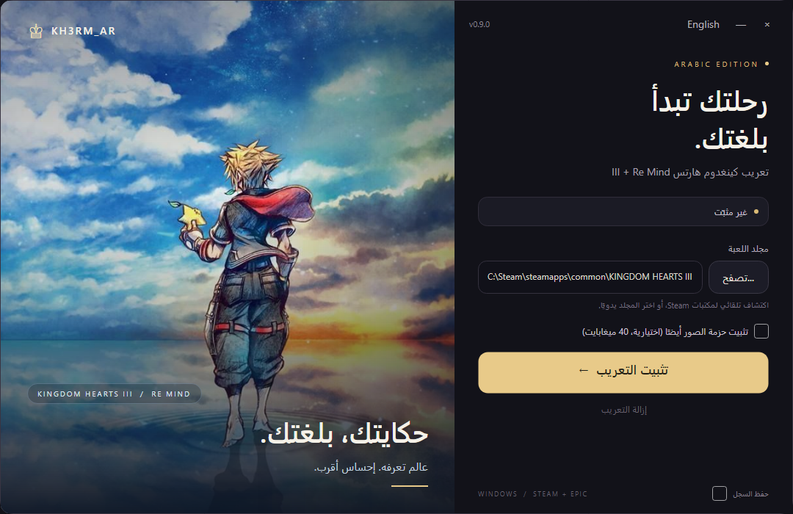

# تعريب Kingdom Hearts III + Re Mind

**ترجمة عربية غير رسمية من المعجبين للعبة Kingdom Hearts III + Re Mind على الكمبيوتر (PC).** مجانية، وغير تابعة لشركتي Square Enix أو Disney.

> **الحالة: نسخة تجريبية (pre-release).** الترجمة مكتملة لكن لم تُختبر داخل اللعبة بالكامل بعد.

## ماذا تشمل الترجمة

- القوائم والواجهة، والعناصر والقدرات
- الشروحات (tutorials)
- دفتر اليوميات (journal)
- كل الترجمة النصية للمشاهد السينمائية والحوارات
- Re Mind
- خط الواجهة العربي
- الهاشتاقات

## التنزيل

**[نزّل الإصدار 0.8.3 (نسخة تجريبية)](https://github.com/exelight7/KH3RM_AR/releases/tag/0.8.3)** وكل الإصدارات في صفحة [Releases](../../releases). الإصدارات الحالية كلها تجريبية، لذلك قد لا يظهر زر «Latest» في GitHub.

## التثبيت (٤ خطوات)

1. أغلق اللعبة، ثم شغّل `KH3RM_AR_Setup_v0.8.2.exe`.
2. إن ظهرت نافذة SmartScreen (المثبّت غير موقّع): اضغط «More info» ثم «Run anyway».
3. اختر مجلد اللعبة (Steam أو Epic)؛ يبحث عنه المثبّت تلقائيا، فإن لم يجده اختره بنفسك.
4. اضغط «تثبيت». يتحقق المثبّت من الملف بـ SHA256.

### التثبيت اليدوي

1. نزّل `pakchunk99-arabic_P.pak` من صفحة [Releases](../../releases).
2. انسخه إلى مجلد `Content\Paks\~mods` داخل مجلد اللعبة (أنشئ `~mods` إن لم يكن موجودا). مثال:
   `C:\Program Files (x86)\Steam\steamapps\common\KINGDOM HEARTS III\KINGDOM HEARTS III\Content\Paks\~mods`
3. أبقِ ملف pak واحدا فقط من هذا التعريب في المجلد.

## الإزالة

احذف `pakchunk99-arabic_P.pak` من `~mods` (أو شغّل `REMOVE_AR.bat`) واللعبة مغلقة. لا نغيّر أي ملف أصلي من اللعبة.

## حالة التطوير

| المقياس | النتيجة |
|---|---|
| مترجم من النص القابل للترجمة | 100.0% (16,415 سطرا) |
| مراجَع لغويا | مرتين |
| تم التحقق منه بلقطة شاشة داخل اللعبة | 0.6% فقط (98 سطرا) |

الترجمة اكتملت، والمراجعة تمت مرتين، لكن التحقق الفعلي داخل اللعبة لم يشمل إلا نسبة صغيرة جدا. فتوقّع أن تجد أسطرا تحتاج إلى تصحيح، وبلاغاتك هي ما يرفع هذه النسبة. (الأرقام من `state/STATS.md`.)

## خارطة الطريق

| الإصدار | المحتوى |
|---|---|
| 0.9.0 | حزمة صور اختيارية (نصوص مرسومة داخل الصور) |
| 0.9.1 | صور الألعاب المصغّرة |
| 0.9.2 – 0.9.8 | إصلاحات من نتائج الاختبار |
| 0.9.9 | نسخة مرشّحة للإصدار النهائي |
| 1.0.0 | بعد أن يلعب صاحب المشروع اللعبة كاملة فقط |

## مشاكل معروفة

- علامة الاستفهام العربية غير مثبتة بعد، فنستعمل `?` اللاتينية.
- قد تُقطع بعض الأسطر الطويلة في صناديق الواجهة.
- تحديثات Steam قد تكسر الملف؛ أعد التثبيت بعدها.

## الإبلاغ عن مشكلة

افتح [بلاغا جديدا](https://github.com/exelight7/KH3RM_AR/issues/new/choose) بالقالب الجاهز: سطر واحد (الكلمات التي رأيتها، المكان، نوع المشكلة) مع لقطة شاشة. التفاصيل في [دليل المختبر](docs/TESTER_GUIDE.md). وللبحث عن السطر المقصود استعمل `python tools\find_text.py <كلمة>`.

## الشكر

المؤلف: [exelight7](https://github.com/exelight7). المشروع الأقدم لتعريب Kingdom Hearts II Final Mix: [KH2FM_AR](https://github.com/exelight7/KH2FM_AR).

## البناء من المصدر

تحتاج نسختك الخاصة من اللعبة؛ مفتاح المجتمع **لا يوزَّع** هنا.

1. ثبّت Python وضع مفتاحك ونسخة اللعبة كما في `technical/RECON_KH3.md`.
2. `python tools\merge_translation.py --check` ثم `python tools\validate.py`.
3. `python tools\build_build7.py` يبني ملف pak.
